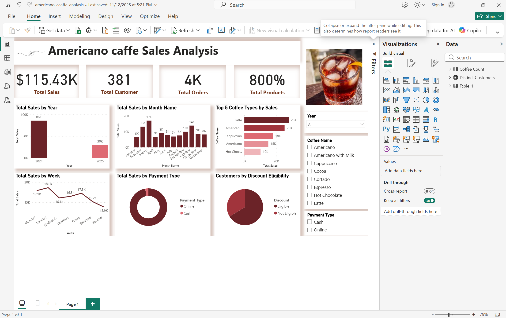

# ☕ Americano Caffe – Sales Analysis Dashboard

## 📌 Project Overview

An interactive Sales Analysis Dashboard developed using Microsoft Power BI to analyze cafe sales data and generate meaningful business insights.

## 🎯 Project Objectives

- Analyze cafe sales performance.
- Understand sales and revenue trends.
- Identify customer purchasing patterns.
- Monitor key business performance indicators.
- Support data-driven business decisions.

## 🛠️ Tools & Technologies

- Microsoft Power BI
- Power Query
- DAX
- Data Cleaning
- Data Visualization
- Data Analysis

## 📊 Dashboard Preview

## 📈 Key Analysis Areas

- Sales Performance Analysis
- Revenue Analysis
- Product and Category Analysis
- Customer Purchasing Trends
- Business Performance Monitoring

## 📂 Project Files

| File | Description |
|---|---|
| americano_caaffe_analysis.pbix | Power BI project |
| dashboard_overview.png | Dashboard screenshot |

## 🚀 How to Run

1. Download the PBIX file from this repository.
2. Install Microsoft Power BI Desktop.
3. Open the downloaded PBIX file.
4. Explore the interactive dashboard.

## 👨‍💻 Author

**Suraj Pinjare**

B.Tech – Artificial Intelligence & Data Science

GitHub: [SURAJPINJARE1234](https://github.com/SURAJPINJARE1234)

---

⭐ If you find this project useful, consider starring this repository.
